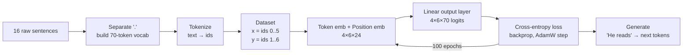

# llm-from-scratch-v0-embedding

A small next-word language model, written from scratch in PyTorch, that adds **token embeddings, positional embeddings and a linear output layer** on top of the dummy model.

> **This project extends [llm-from-scratch-dummy](https://github.com/sravanipamu/llm-from-scratch-dummy).**
> Start with the dummy project if you haven't seen it. It explains the basic training loop with a 2-parameter model. This project keeps the same loop and replaces the model with the first real building blocks of a GPT-style LLM.

---

## 1. Overview

### Why this project?

The dummy model predicts the next word with one straight line, `y = w·x + b`. That works for two sentences, but it can't work for real text, because:

- It treats token IDs as **quantities**: it assumes word `5` is "bigger" than word `4`, which means nothing.
- It outputs **one number**, not a choice between words, so it can't say how likely each word is.
- It sees only **one word** of context and doesn't know where a word sits in the sentence.

This project fixes those problems using the same techniques real LLMs use:

1. Every word gets its own learned **vector** (token embedding) instead of being a single number.
2. Every position in the sentence gets its own learned vector (**positional embedding**), so the model knows word order.
3. A **linear output layer** produces a score (logit) for **every word in the vocabulary**, and **cross-entropy loss** trains it to give the correct next word the highest score.

**Who is this for?** Learners who finished the dummy project and want to see the next step toward a GPT-style model. You only need basic Python. No GPU is required.

### What's new compared with the dummy project

| | [llm-from-scratch-dummy](https://github.com/sravanipamu/llm-from-scratch-dummy) | **llm-from-scratch-v0-embedding** (this project) |
|---|---|---|
| Training data | 2 sentences (`"He boy"`, `"She girl"`) | 16 longer sentences |
| Vocabulary | 4 words | 70 tokens (words plus `.`) |
| Tokenizer | Split on spaces | Split on spaces, with `.` separated into its own token |
| Context length | 1 word | 6 tokens |
| Word representation | Raw token ID (a single number) | 24-dimensional **token embedding** |
| Word order | Not modelled | 24-dimensional **positional embedding** |
| Model | `w·x + b` (2 parameters) | Embeddings + linear output layer (3,504 parameters) |
| Output | One number, rounded to a token ID | 70 logits, one score per vocabulary token |
| Loss | Mean Squared Error | **Cross-Entropy** (standard for LLMs) |
| Optimizer | AdamW, lr 0.1 | AdamW, lr 0.0003, weight decay 0.1 |
| Generation | One next word | Several tokens in a loop, picking the highest score (greedy decoding) |
| Inspection | None | Counts parameters per layer |

### What is still missing

There's no **attention** yet. Each position predicts the next token using only its own embedding plus its position, so the model can't combine information from earlier words. That's why the generated text below is only partly sensible. Attention and Transformer blocks are added in the next version (v1).

---

## 2. Architecture

```
               ┌──────────────────────────────────────────────────────────────┐
  Text   ──►   │ Tokenizer          "He reads books ." ──► [1, 49, 5, 0]      │
               ├──────────────────────────────────────────────────────────────┤
               │ Dataset            x = first 6 tokens                        │
               │ (next-token)       y = same tokens shifted right by 1        │
               ├──────────────────────────────────────────────────────────────┤
               │ Token Embedding    nn.Embedding(70, 24)   id  ──► vector     │
               │        +                                                     │
               │ Position Embedding nn.Embedding(6, 24)    pos ──► vector     │
               ├──────────────────────────────────────────────────────────────┤
               │ Output Layer       nn.Linear(24, 70)  vector ──► 70 logits   │
               ├──────────────────────────────────────────────────────────────┤
               │ Loss + Optimizer   CrossEntropyLoss, AdamW (lr = 0.0003)     │
               ├──────────────────────────────────────────────────────────────┤
               │ Generator          argmax(logits) ──► next id ──► repeat     │
               └──────────────────────────────────────────────────────────────┘
```

Shapes for one batch (batch size `B = 4`, context `T = 6`):

```
input ids        (B, T)          = (4, 6)
token embeds     (B, T, EMB_DIM) = (4, 6, 24)
+ pos embeds     (T, EMB_DIM)    = (6, 24)      broadcast over the batch
= x              (4, 6, 24)
logits           (B, T, VOCAB)   = (4, 6, 70)
```

| Component | What it does | Parameters |
|---|---|---|
| **Tokenizer** | Separates `.` from words, splits on spaces and maps each token to an ID. | – |
| **`LLMDataset` / DataLoader** | Takes the first `CONTEXT_LEN + 1` tokens of each sentence and makes input `x` and target `y` (shifted by one). | – |
| **`tok_emb`** | Lookup table: one learned 24-number vector per vocabulary token. | 70 × 24 = 1,680 |
| **`pos_emb`** | Lookup table: one learned 24-number vector per position (0–5). | 6 × 24 = 144 |
| **`output_layer`** | Turns each 24-number vector into 70 scores (logits), one per token. | 24 × 70 = 1,680 |
| **Loss** | `CrossEntropyLoss` compares the logits with the correct next-token ID. | – |
| **Optimizer** | `AdamW` updates all 3,504 parameters. | – |
| **Generator** | Repeatedly predicts the next token and appends it to the input. | – |

---

## 3. Workflow / Data Flow



Step by step, in the same order as the notebook:

1. **Define the data:** 16 sentences about what "He" and "She" do.
2. **Set the configuration:** `VOCAB_SIZE`, `CONTEXT_LEN`, `EMB_DIM`, `BATCH_SIZE`, `EPOCHS`.
3. **Fix the random seed** (`torch.manual_seed(123)`) so results are reproducible.
4. **Pre-process:** `separate_dots` turns `"daily."` into `"daily ."` so the full stop is its own token.
5. **Build the vocabulary:** collect and sort all unique tokens (70 in total).
6. **Create mappings:** `word_to_id` and `id_to_word`.
7. **Tokenize:** `text_to_token_ids("She composes songs ...") → [2, 11, 55, 3, 46, 45, 14, 0]`.
8. **Build the dataset:** keep the first 7 tokens, then `x = tokens[:-1]` and `y = tokens[1:]`. The DataLoader groups them into 4 batches of 4.
9. **Create the model:** token embedding + positional embedding + linear output layer.
10. **Count parameters:** 3,504 in total (see the table above).
11. **Train:** for 100 epochs, compute logits, flatten them, compute cross-entropy loss, backpropagate and update.
12. **Generate:** start from a prompt, predict the next token with `argmax`, append it and repeat until the context is full.

---

## 4. Tech Stack

| Item | Used for |
|---|---|
| **Python 3.10+** | Programming language |
| **PyTorch** | Tensors, `nn.Embedding`, `nn.Linear`, `CrossEntropyLoss`, `AdamW`, `Dataset` / `DataLoader` |
| **`re`** (standard library) | Separating full stops from words |
| **`collections.defaultdict`** (standard library) | Counting parameters per layer |
| **Jupyter Notebook** | Running the code cell by cell and seeing the output |

`requirements.txt` also lists `matplotlib`, `seaborn`, `requests`, `tensorflow`, `tiktoken` and `tqdm`. They aren't used by `v0.ipynb`, but they are kept so the same environment works for the later versions of the series. To run only this notebook, `torch` is enough.

---

## 5. Project Structure

```
llm-from-scratch-v0-embedding/
├── v0.ipynb           # The whole project: data → tokenizer → embeddings → training → generation
├── requirements.txt   # Python packages
├── .gitignore         # Files Git should ignore (venv, caches, checkpoints, models/)
└── README.md          # This file
```

---

## 6. Installation

**Prerequisites:** Python 3.10 or newer, and `git`.

```bash
# 1. Clone the repository
git clone <this-repository-url> llm-from-scratch-v0-embedding
cd llm-from-scratch-v0-embedding

# 2. Create a virtual environment
python3 -m venv .venv

# 3. Activate it
source .venv/bin/activate        # macOS / Linux
# .venv\Scripts\activate         # Windows (PowerShell or cmd)

# 4. Install the dependencies
pip install -r requirements.txt
#    or, for this notebook only:
# pip install torch numpy

# 5. Register the environment as a Jupyter kernel
pip install ipykernel
python -m ipykernel install --user --name llm-from-scratch-v0-embedding --display-name "llm-from-scratch-v0-embedding"
```

---

## 7. Configuration

No environment variables, API keys or config files are needed. All settings are in the notebook:

| Setting | Default | Meaning |
|---|---|---|
| `data` | 16 sentences | Training text |
| `VOCAB_SIZE` | `70` | Number of unique tokens. **Must match `len(vocab)`**; update it if you change `data`. |
| `CONTEXT_LEN` | `6` | How many tokens the model sees at once (also the number of positional embeddings) |
| `EMB_DIM` | `24` | Length of each embedding vector |
| `BATCH_SIZE` | `4` | Sentences per training step |
| `EPOCHS` | `100` | Full passes over the data |
| `lr` | `0.0003` | Learning rate (AdamW) |
| `weight_decay` | `0.1` | AdamW regularisation, which keeps weights small |
| `torch.manual_seed(123)` | `123` | Makes results reproducible |

---

## 8. Execution

**Option A: VS Code**
1. Open the folder in VS Code (with the *Python* and *Jupyter* extensions installed).
2. Open `v0.ipynb`.
3. Click **Select Kernel** and choose **llm-from-scratch-v0-embedding**.
4. Click **Run All**.

**Option B: Jupyter in the browser**
```bash
pip install notebook
jupyter notebook v0.ipynb
```
Then choose **Kernel → Change kernel → llm-from-scratch-v0-embedding** and **Run → Run All Cells**.

---

## 9. Example

**Input (first training sentence):**
```
She composes songs and practices piano daily.
```

**After tokenization:**
```python
[2, 11, 55, 3, 46, 45, 14, 0]      # She composes songs and practices piano daily .
x = [2, 11, 55, 3, 46, 45]         # input
y = [11, 55, 3, 46, 45, 14]        # target (shifted by one)
```

**Parameter count:**
```
Total trainable parameters: 3,504
tok_emb             : 1,680
pos_emb             : 144
output_layer        : 1,680
```

**Training output (loss goes down):**
```
Epoch: 1
batch: 1 loss: 4.721181
...
Epoch: 100
batch: 1 loss: 2.628815
batch: 2 loss: 2.779463
batch: 3 loss: 2.740181
batch: 4 loss: 2.673895
Done!
```
A starting loss of about 4.25 (`ln 70`) means random guessing among 70 tokens. Dropping to about 2.7 shows the model has learned which tokens tend to follow which.

**Generation:**
```python
generate("He reads")       # → He reads books composes and with
generate("She composes")   # → She composes harmonies and curates navigation
```
The model correctly learns common pairs such as `He → reads`, `reads → books` and `She → composes → harmonies → and`. It can't keep track of the whole sentence because it has no attention, so later words drift. This is the limitation the next version fixes.

---

## 10. Key Concepts

| Concept | Simple explanation |
|---|---|
| **Token embedding** | A learned vector for each token. Similar words can end up with similar vectors, which a single ID number can't express. |
| **Positional embedding** | A learned vector for each position. Added to the token embedding so the model knows *where* a word appears. |
| **Embedding dimension** | The length of each vector (`EMB_DIM = 24`). Real LLMs use 768 to 12,288. |
| **Logits** | Raw scores, one per vocabulary token. The highest score is the model's best guess. Softmax turns them into probabilities. |
| **Linear output layer (LM head)** | Maps a vector of size `EMB_DIM` to `VOCAB_SIZE` logits. |
| **Cross-entropy loss** | Measures how much probability the model gave the correct next token. This is the standard LLM training loss. |
| **Next-token prediction** | Target = input shifted by one. Every position in the sequence is a training example. |
| **Context length** | Maximum tokens the model sees at once. Here it's 6, and also the size of the position table. |
| **Batching** | Training on several sequences together. Shapes become `(batch, seq_len, …)`. |
| **`flatten(0, 1)`** | Merges batch and sequence dimensions so `CrossEntropyLoss` gets `(N, VOCAB)` logits and `(N,)` targets. |
| **AdamW + weight decay** | The optimizer used by most LLMs. Weight decay gently pulls weights toward zero to reduce overfitting. |
| **Greedy decoding** | During generation, always pick the token with the highest logit (`argmax`). |
| **Autoregressive generation** | Each predicted token is appended to the input and fed back in to predict the next one. |

---

## 11. Troubleshooting

| Problem | Solution |
|---|---|
| `ModuleNotFoundError: No module named 'torch'` | The notebook is using the wrong Python. Select the **llm-from-scratch-v0-embedding** kernel, or activate `.venv` and run `pip install -r requirements.txt`. |
| `pip install -r requirements.txt` fails on `tensorflow` | TensorFlow isn't needed for this notebook. Run `pip install torch numpy` instead, or use a Python version TensorFlow supports. |
| `IndexError: index out of range in self` (in `tok_emb`) | `VOCAB_SIZE` is smaller than the real vocabulary. After changing `data`, set `VOCAB_SIZE = len(vocab)`. |
| `IndexError` in `pos_emb`, or a shape mismatch | A sequence is longer than `CONTEXT_LEN`. Keep prompts at most `CONTEXT_LEN` tokens; `generate` trims to the last `CONTEXT_LEN` tokens. |
| `RuntimeError: stack expects each tensor to be equal size` | A sentence has fewer than `CONTEXT_LEN + 1` tokens. Make every sentence at least 7 tokens long, or lower `CONTEXT_LEN`. |
| `KeyError` in `generate` | The prompt contains a word that isn't in the vocabulary. Words are case-sensitive, and `.` must be separated by spaces. |
| Generated text doesn't make sense | Expected: there's no attention yet. You can lower the loss by increasing `EPOCHS` or the learning rate, but full sentences need the Transformer added in v1. |
| `NameError` (for example `model is not defined`) | Cells were run out of order. Use **Restart Kernel → Run All**. |
| Kernel doesn't appear in VS Code | Run step 5 of [Installation](#6-installation) again, then reload VS Code. |

---

## Related Projects

- **Previous step:** [llm-from-scratch-dummy](https://github.com/sravanipamu/llm-from-scratch-dummy): tokenization and the training loop with a 2-parameter linear model.
- **Next step:** v1: adds a Transformer block with self-attention.
